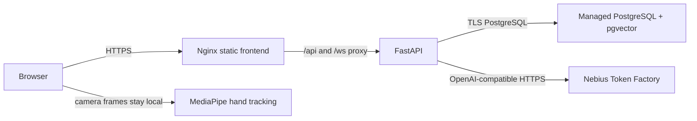

# Submission deployment notes

Status date: 2026-10-20. This repository contains container deployment definitions, but a public deployment has not been provisioned or verified. No hosting or managed database credentials are present in this checkout. Do not treat a local container run as the required public demo.

## Runtime architecture



The backend runs Alembic migrations at container startup. The frontend container serves the Vite build and proxies API and WebSocket traffic to the backend. Put a managed PostgreSQL service with the pgvector extension behind `ORBIT_DATABASE_URL`. Terminate HTTPS at the hosting platform's ingress or load balancer. Persist database backups there; application containers are stateless.

## Nebius model routing

Set `LLM_PROVIDER=nebius`, `NEBIUS_API_KEY`, and `NEBIUS_BASE_URL=https://api.tokenfactory.nebius.com/v1/`. `MODEL_PLANNER` is the configured model for planning and longer reasoning; `MODEL_FAST` is used for lower-latency classification and short responses; `MODEL_EMBED` supplies embeddings. These IDs are deployment inputs, not hard-coded recommendations. Inspect the current Token Factory model catalog and confirm each chosen model's API/task compatibility before launch. The provider's live behavior has not been verified from this checkout.

Keep provider keys and `ORBIT_JWT_SECRET` in the host's secret manager. Set `ORBIT_ALLOWED_ORIGINS` to the exact public origin(s), and use the database provider's TLS connection string. Do not expose the backend port publicly when the frontend proxy is used.

## Container run

The deployment compose file expects a reachable managed PostgreSQL database and required environment values. From the repository root, export values from a secret manager or provide them through a private, untracked `.env` file, then run:

```bash
docker compose -f docker-compose.app.yml config
docker compose -f docker-compose.app.yml up --build -d
```

The web app will be available on port 8080 by default. Configure the host's HTTPS ingress to that port. `docker-compose.yml` remains the separate local pgvector development database. Production should use the hosting provider's managed Postgres rather than the local database service.

## Demo account and sample data

After deployment, run `python scripts/seed_demo.py` from the repository root with `ORBIT_API_BASE_URL`, `ORBIT_DEMO_EMAIL`, and `ORBIT_DEMO_PASSWORD` set. The script registers the account (or logs in when it already exists) and idempotently creates three synthetic memories and two tasks. No shared credentials are committed. Publish the credentials through the submission channel rather than this repository, then confirm sign-in and sample data visibility before sharing the demo URL.

## Changes during the submission period

- Added a Nebius/NVIDIA compatible model gateway and configurable task model routing.
- Added authentication, scoped persistent memory, structured agent tools, scheduling, and approval-gated workspace intelligence.
- Added streamed chat, a browser vision interaction, and a VS Code extension package.
- Added backend/frontend container definitions and a managed-database deployment compose file for submission packaging.

The public URL, seeded demo account, selected live model IDs, and live provider validation remain deployment-time items.
