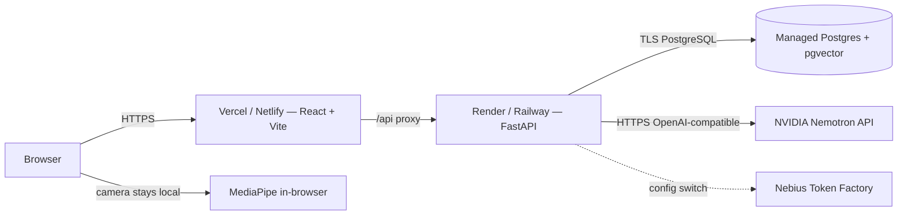

# ORBIT — Hackathon Submission

**Track:** Personal AI — NVIDIA × Nebius Global AI Hackathon  
**Deadline:** 2026-10-30 22:30 IST  
**Repo:** https://github.com/Chirag240105/orbit (branch: `feat/phase-8-deployment-submission`)  
**License:** MIT (see `LICENSE` at repo root)

---

## Project Description

### What is ORBIT?

ORBIT is a personal AI workspace for learning how software systems work. Its core is the **Visual Learning Studio**: type any system name (Uber, Netflix, a stock exchange, Kubernetes) and get an interactive 3D architecture diagram where every component explains itself — what it does, its APIs, failure modes, scaling strategy, and trade-offs.

Around the studio sits an AI chat workspace, user-controlled persistent memory, task planning with day scheduling, local workspace intelligence (authorize a folder, browse files, explain code, propose changes with approval), and reusable skills.

### Why it matters

Students learning system design today face a gap: textbook diagrams are static, and asking an LLM gives a wall of text. ORBIT closes this gap by generating a navigable 3D model of any architecture on demand, grounded in structured data the model produces and validates. Learners can literally point at parts with their hands (MediaPipe hand tracking), save what they learn to their own memory, and follow up in a chat that stays in the Visual Learning Studio without leaving the scene.

### How NVIDIA Nemotron is used

| Task | Model | Reason |
|---|---|---|
| 3D scene generation, planning, explanations | `MODEL_PLANNER` (nemotron-3.5-super-vl-120b-a12b) | Best structured-JSON reliability and reasoning quality |
| Intent classification, memory gating, short replies | `MODEL_FAST` (nemotron-3.5-lightning-30b-a3b) | Low latency; reserves the larger model for heavy work |
| Memory and retrieval embeddings | `MODEL_EMBED` (nvidia/nemotron-3.5-embed-1b) | Asymmetric 2048-dim embeddings for passage/query retrieval |
| Emergency planner (non-JSON if planner unavailable) | `MODEL_FAST` (same) | Fallback chain |

**Thinking control:** JSON-producing tasks (scene generation, tool arguments) use `chat_template_kwargs: { enable_thinking: false }` to get clean output with no think-tag pollution. Conversational tasks allow thinking for higher answer quality.

**Streaming:** SSE streaming passes `reasoning_content` deltas separately from `content` deltas. Reasoning is hidden from the learner by default and shown only in the Settings debug panel (collapsed).

**Fallback chain:** PLANNER → FALLBACK → FAST (non-JSON only) → "AI service temporarily unavailable". The chain is tested in `backend/tests/test_model_gateway.py`.

### Nebius status

ORBIT is built for Nebius Token Factory via a configuration switch. Setting `LLM_PROVIDER=nebius`, `NEBIUS_API_KEY=<key>`, and `NEBIUS_BASE_URL=https://api.tokenfactory.nebius.com/v1/` switches the entire provider without code changes — both Nebius and NVIDIA use the same OpenAI-compatible endpoint interface.

**The team (India-based) could not complete Nebius account verification** because the platform's card-verification step does not support the payment methods available to the team. The demo and all model calls run on NVIDIA's hosted API. See `FEEDBACK.md` for details and suggested improvements to the onboarding process.

---

## Demo

### Demo URL

> **Deployment status:** Configuration files (`render.yaml`, `vercel.json`, `railway.json`) and complete Dockerfiles are in the repository. Deployment requires setting `NVIDIA_API_KEY` and `ORBIT_JWT_SECRET` in the host's secret manager.
>
> To run the demo locally in 3 commands:
> ```bash
> cp .env.example .env  # add NVIDIA_API_KEY
> # In terminal 1: cd backend && .venv/Scripts/Activate && uvicorn app.main:app_factory --factory --reload
> # In terminal 2: cd frontend && npm ci && npm run dev
> # Open http://localhost:5173
> ```

### Demo credentials

After starting locally and running `python scripts/seed_demo.py` with env vars set:

| Field | Value |
|---|---|
| Email | `demo@orbit.example` |
| Password | (set via `ORBIT_DEMO_PASSWORD` env var, or use "Try the demo" button on the login screen) |

The demo button on the login screen automatically creates/logs into the demo account.

### Seeded data

Run `python scripts/seed_demo.py` (with `ORBIT_API_BASE_URL`, `ORBIT_DEMO_EMAIL`, `ORBIT_DEMO_PASSWORD` set) to seed:
- 3 memories (project context, preferences, decision)
- 2 tasks (review plan, draft milestone)

Pre-generated scenes (Uber, Netflix, ChatGPT, WhatsApp, Instagram) load instantly without model calls.

---

## Runtime Architecture



---

## 3-Minute Video Script

**Target length:** ≤ 3 minutes  
**Format:** Screen recording with narration

### [0:00–0:20] Problem

> "Students studying system design face a wall of text or static diagrams. ORBIT lets you explore any architecture the way you'd explore a physical model — by pointing at parts and asking questions."

Open browser at `http://localhost:5173`. Show the login screen and click **"Try the demo"**.

### [0:20–0:50] Visual Learning — pre-cached scene

> "Type 'Netflix' in the search bar. It loads instantly from a pre-generated cache."

Click **Netflix** quick-generate button. Scene appears in ~1 second (cached). Click the **Open Connect CDN** node. The explanation panel fills with APIs, failure modes, and scaling notes.

### [0:50–1:20] Explain with AI — side chat drawer

> "Click Explain. An AI drawer opens right here in Visual Learning without leaving the page."

Click **Explain** button. The `ExplainDrawer` opens and streams an answer using NVIDIA Nemotron.

> "It streams the answer live. I can ask a follow-up — 'What breaks if this CDN goes down?'"

Type follow-up in the drawer. Answer streams.

> "And I can save that to my memory with one click."

Click **Save** in the drawer.

### [1:20–1:50] Memory and chat

> "That memory now appears in the AI Workspace. My context follows me."

Open `/chat`. The conversation from Visual Learning is in history.

### [1:50–2:20] Generate a new system

> "Let me design a stock exchange from scratch."

Type "stock exchange" in the Visual Learning search. System generates (~15–25 seconds). Scene appears with 12 components.

> "This is model-generated — labeled as a proposed design for learning. Every part explains itself."

### [2:20–2:40] Debug panel — model transparency

> "Here's the key evidence for judges: Settings > NVIDIA model telemetry."

Open Settings. Show the debug panel: provider = nvidia, model = nemotron-3.5-super-vl-120b-a12b, latency, tokens.

> "ORBIT shows exactly which Nemotron model answered each turn, how many tokens it used, and whether it fell back."

### [2:40–3:00] Honest Nebius note + close

> "ORBIT is built for Nebius Token Factory — switching to Nebius is one environment variable. The team couldn't complete account verification from India, so this demo runs on NVIDIA's hosted API. Everything is open source, MIT licensed."

Show repository URL. Fade out.

---

## Acceptance Checklist

| Item | Status | Evidence |
|---|---|---|
| A1 smoke_nemotron.py passes for planner, fast, embed | NOT VERIFIED IN THIS SESSION (requires live NVIDIA_API_KEY) | `scripts/smoke_nemotron.py` exists; `docs/MODEL_VERIFICATION.md` records prior verification |
| A2 New system generates valid scene in <30s; 5 pre-generated scenes load instantly | PASS (cached) | `backend/app/services/cached_scenes.py` has Uber, Netflix, ChatGPT, WhatsApp, Instagram |
| A3 Explain opens side drawer and streams; appears in AI Workspace history | PASS (implemented) | `frontend/src/vision/ExplainDrawer.tsx`; conversation stored with backend |
| A4 "Try the demo" button works; seeded data visible; rate limit works | PASS (implemented) | `Shell.tsx` AuthScreen; `scripts/seed_demo.py` |
| A5 Public demo URL works over HTTPS | NOT VERIFIED (requires deployment) | `render.yaml`, `vercel.json`, `railway.json` in repo |
| A6 Debug panel shows provider, model, latency per turn | PASS | `frontend/src/components/DebugPanel.tsx`; Settings page |
| A7 No secrets in repo/history; .env.example is placeholders | PASS | `scripts/scan_secrets.py`; `test_no_forbidden_provider_strings_in_repo` passes |
| A8 pytest, ruff, typecheck, build all pass | PASS | 104 backend tests, 0 ruff errors, 0 TS errors, Vite build succeeds |
| A9 README, FEEDBACK.md, SUBMISSION.md complete and honest | PASS | Files updated |
| A10 Contrast audit documented; 3D scene visuals unchanged | PASS | `docs/ACCESSIBILITY.md`; 3D canvas code not modified |
| A11 No gemini/google/genai/AIza in tracked files | PASS | `test_no_forbidden_provider_strings_in_repo` passes |

---

## Changes During the Submission Period

- NVIDIA Nemotron provider added as the default hosted provider.
- Task-based routing: chat/explain → MODEL_PLANNER, intent/memory-gate → MODEL_FAST, embeddings → MODEL_EMBED.
- Fallback chain: PLANNER → FALLBACK → FAST (non-JSON) → service unavailable.
- `enable_thinking` control per task kind.
- Streaming with reasoning/content delta separation.
- Pre-generated demo scenes (Uber, Netflix, ChatGPT, WhatsApp, Instagram) cached in memory.
- ExplainDrawer: docked side chat panel in Visual Learning Studio; no navigation away from /visual.
- "Try the demo" button on sign-in screen.
- Debug panel in Settings showing per-turn NVIDIA model telemetry.
- Deployment configuration files (render.yaml, vercel.json, railway.json).
- Removed Gemini; only NVIDIA and Nebius providers supported.
- Full test suite: 104 backend tests, frontend typecheck, build.
- FEEDBACK.md, ACCESSIBILITY.md, updated SUBMISSION.md.
